# 00 — Phase 0 Audit

**Project:** AI Classroom Attendance System (`DL_PROJECT`)
**Audit date:** 2026-09-29
**Auditor:** Principal Engineer (incoming)
**Branch at audit:** `main` @ `7947205 ram`
**Scope:** Read-only discovery. No source code was modified.

> **Honesty statement.** Every finding below is derived from reading the actual code, the
> actual SQLite database, and by executing the actual test suites on the audit machine.
> Where I could not verify something (no hardware present), I say **UNVERIFIED** and give the
> protocol to verify it. I have invented no benchmark numbers.

## Current Re-audit — 2026-09-30

This section supersedes the maturity claims in the 2026-09-29 snapshot below where later work
has changed the code. The original findings remain as historical context; they are not a current
description of every subsystem. This pass inspected the current source tree, ran the cloud suite
and ROS workspace tests, and added focused W6 evaluation/benchmark coverage. The working tree
already contained uncommitted W6 implementation files before this pass; they remain uncommitted.

| Workstream | Current status | Evidence and remaining boundary |
|---|---|---|
| W1–W3 | **Implemented per prior workstream records** | Repo safety/tooling, correctness/domain core and identity/vector-index layers are present; cloud and ROS verification is recorded below. |
| W4 | **Substantially implemented; production decisions remain** | `app/api/routes_v1.py`, `app/models/tenancy.py`, `app/services/tenancy.py`, `tests/test_tenancy.py`, `tests/test_v1_api.py`: tenant auth/RBAC, consent, roster, audited operations, session lifecycle and CSV register exist. Deployment-grade identity provisioning and policy review still need operator/legal sign-off. |
| W5 | **Partially implemented** | `ros_ws/` builds all seven packages and passes 259 edge tests on Jazzy. `docs/PROGRESS.md` records a verified simulated 16-frame sweep. The sweep is not wired to the durable outbox; phone-app and physical hardware paths remain unverified. |
| W6 | **Partially implemented; active WIP** | The perception pipeline batches through `InsightFaceEmbedder`; the permissive SFace adapter satisfies the batch contract with a serial loop because its API is single-image. Calibration CLI, consented data protocol, held-out verification-pair evaluator and aggregate-only `scripts/benchmark_pipeline.py` exist. Liveness backends are placeholders, are not consulted by the perception path, and perform no anti-spoof check. Real-data TAR@FAR remains unavailable. |
| W7 | **Partial foundations only** | `UnknownCluster` storage and `unresolved_clusters()` exist, as do identity resolution and a legacy Streamlit tester. No complete unknown-cluster operator workflow, conversational API, or gated metric-update/version/rollback/poisoning/gallery-aging service was found. |
| W8 | **Partial** | `app/api/routes_v1.py` closes sessions and serves register JSON/CSV. XLSX/PDF export, timetable-driven scheduling and webhook delivery are absent. |
| W9 | **Partial** | Consent checks, biometric erasure service/API, retention and an S3 SSE-KMS storage adapter exist. Erasure can report pending object keys rather than proving external deletion; legal/compliance approval, end-to-end KMS/key lifecycle and verification remain open. |
| W10 | **Partial** | Prometheus-style metrics, request instrumentation and health/readiness endpoints exist in `app/observability/metrics.py` and `app/main.py`. Fault-injection coverage, OpenTelemetry trace integration and an operator debug visualizer were not found. |
| W11 | **Partial** | `Dockerfile` and `docker-compose.yml` exist, but the Dockerfile is single-stage. No Terraform files were found; edge installer and cost model are absent. |
| W12 | **Partial** | `scripts/measure_channel_order.py`, `scripts/sweep_detector.py`, `scripts/evaluate.py` and `docs/benchmarks.md` cover focused measurements and held-out verification-pair evaluation. A synthetic classroom generator and `docs/LIMITATIONS.md` are absent. Real classroom attendance accuracy remains **UNVERIFIED**. |

### Re-audit validation and risks

- Full cloud suite: **431 passed, 4 warnings**. Warnings are Starlette/httpx and FastAPI status-code deprecations.
- Edge workspace: **7 packages built; 259 tests passed**, 0 failures. One existing warning remains because `attendance_mocks/test/manual_test.py::test_angle_normalisation` returns a value instead of asserting.
- `ruff check app tests scripts` passes; repository-wide `ruff format --check` reports 15 files to format. `mypy app` has **10 remaining errors**, all in legacy `app/api/routes.py`; the typing-ratchet tests pass. The invalid per-module mypy config syntax has been corrected.
- The calibration fixture had been committing setup rows without adding attendance events to the SQLAlchemy session, and reused a fixed tenant slug in the process-shared in-memory database; both fixture problems are corrected.
- The repository still contains biometric-related human actions that cannot be completed by code alone: licensing/legal decisions, git-history purge approval, consented held-out classroom data, and physical phone/servo verification. See `docs/HUMAN_ACTIONS.md`.
- The benchmark harness has not been run on consent-approved real images. The held-out evaluator measures verification pairs only; do not present it as classroom false-present performance or treat the system as production-complete.

---

## 1. Environment as Measured

| Item | Measured value | How verified |
|---|---|---|
| OS | Ubuntu 24.04.5 LTS (noble) | `lsb_release -a` |
| Kernel | 7.0.0-31-generic | `uname -a` |
| ROS distro installed | **ROS 2 Jazzy** (`/opt/ros/jazzy`, `ros2` CLI present) | `ls /opt/ros/jazzy` |
| ROS Python | 3.12.3 (`/usr/bin/python3`) | `--version` |
| App venv Python | **3.13.11** (`.venv`) | `--version` |
| `colcon` | `/usr/bin/colcon` present | `which colcon` |
| insightface | **1.0.1** installed (requirements say `>=0.7.3`) | import probe |
| onnxruntime | 1.29.0 | import probe |
| faiss | 1.15.0 (`faiss-cpu`) | import probe |
| opencv | 5.0.0 (`cv2`) — present but **never imported by app code** | import probe |
| torch | **MISSING** | import probe |
| ruff / mypy / black | present only in `~/anaconda3/bin`, **not in `.venv`, no config file** | `which`, `ls` |
| Models | `~/.insightface/models/buffalo_l` downloaded (5 ONNX, 289 MB) | `ls -la` |
| DB | `attendance.db`, SQLite, 1.5 MB | `sqlite3` |
| Image data | `data/` = **850 MB**, `ENROLL_PHOTOS/` = **74 MB** | `du -sh` |
| Git repo | **919 MB** `.git`, 650 tracked files | `du -sh .git` |

**Critical environment finding — the two halves of this project cannot currently talk to each
other.** The ROS nodes need `rclpy` from `/usr/bin/python3` (3.12). The FastAPI/DL app runs in
`.venv` on 3.13. `rclpy` is **not importable** from `.venv` (verified: `ModuleNotFoundError`).
This is not a bug to be patched; it is a design decision that must be made explicitly (see
Question Q1).

**ROS package builds and tests clean on Jazzy.** Verified in an isolated copy at
`/tmp/opencode/ros_ws` (I did not pollute the repo):

```
colcon build   -> Summary: 1 package finished [2.43s]
colcon test    -> Summary: 57 tests, 0 errors, 0 failures, 0 skipped
```

---

## 2. What Actually Exists — Architecture

The repository is **two disconnected systems** plus a Streamlit tester UI. There is **no code
path connecting them**. I grepped for `http`, `requests`, `8000`, `fastapi`, `mqtt`, `websocket`,
`serial` across the entire ROS package: the only hits are in *docstrings describing future work*.

```mermaid
graph TB
    subgraph SILO_A["SILOS A — ROS 2 (attendance_robot/, Jazzy, Python 3.12)"]
        direction TB
        SC["scan_controller<br/>orchestrates 6 fixed angles<br/>[WORKING · SIMULATED]"]
        MC["motor_controller<br/>fake pan, constant velocity<br/>[WORKING · SIMULATED]"]
        CI["camera_interface<br/>returns true, no image<br/>[STUB]"]
        SC -->|"/stand/set_target"| MC
        SC -->|"service /camera/capture"| CI
    end

    subgraph GAP["❌ NO BRIDGE ❌<br/>no import, no HTTP, no MQTT,<br/>no shared message type"]
    end

    subgraph SILO_B["SILO B — FastAPI + InsightFace (.venv, Python 3.13)"]
        direction TB
        UI["ui/app.py Streamlit<br/>713 lines, 5-step wizard<br/>[PARTIAL]"]
        API["app/api/routes.py<br/>597 lines, 20 endpoints<br/>[WORKING]"]
        PROC["app/services/attendance.py<br/>tiling + dedup + routing<br/>[WORKING · CPU only]"]
        REC["app/pipeline/recognizer.py<br/>InsightFace SCRFD+ArcFace<br/>[WORKING · see §4 defect]"]
        IDX["app/services/gallery.py<br/>FAISS IndexFlatIP 1-NN<br/>[WORKING · see §5 defect]"]
        SQLITE[("SQLite<br/>6 tables")]
        UI -->|HTTP| API
        API --> PROC --> REC --> IDX
        PROC --> SQLITE
    end

    GAP -.-> SC
    GAP -.-> API

    style GAP fill:#5a1010,stroke:#ff4444,stroke-width:3px,color:#fff
    style SILO_A fill:#1a2a3a
    style SILO_B fill:#2a1a3a
```



### 2.1 ROS interface as it exists today

All topics use stock `std_msgs` / `std_srvs`. **No custom `.msg` / `.srv` / `.action` files.**
This is stated explicitly in `package.xml:36-39` ("using std_srvs/Trigger for simplicity").

| Kind | Name | Type | Node | Maturity |
|---|---|---|---|---|
| Topic (pub) | `/stand/current_angle` | `std_msgs/Float64` | motor | working (simulated) |
| Topic (pub) | `/stand/target_angle` | `std_msgs/Float64` | motor | working (simulated) |
| Topic (pub) | `/stand/status` | `std_msgs/String` | motor | working (simulated) |
| Topic (sub) | `/stand/set_target` | `std_msgs/Float64` | motor ← scan | working (simulated) |
| Service | `/stand/stop` | `std_srvs/Trigger` | motor | working (simulated e-stop) |
| Service | `/stand/reset` | `std_srvs/Trigger` | motor | working (simulated) |
| Topic (pub) | `/camera/status` | `std_msgs/String` | camera | stub |
| Topic (pub) | `/camera/capture_count` | `std_msgs/Int32` | camera | stub |
| Service | `/camera/capture` | `std_srvs/Trigger` | camera | **stub — returns `True`, never produces an image** |
| Topic (pub) | `/scan/status` | `std_msgs/String` | scan | working |
| Topic (pub) | `/scan/current_index` | `std_msgs/Int32` | scan | working |
| Service | `/scan/start`, `/scan/stop` | `std_srvs/Trigger` | scan | working |
| Topic (sub) | `/robot_description`, `/joint_states` | — | `robot_state_publisher` | working |

`sensor_msgs` is declared in `package.xml` but **never imported** by any node (verified: 1 match,
which is the docstring). Nothing publishes an image.

### 2.2 HTTP interface as it exists today

21 endpoints, all behind a single shared-secret API key (`app/api/routes.py:20`).

| Method | Path | Purpose |
|---|---|---|
| POST | `/students/enroll` | 8–15 photos → gallery |
| POST | `/students/import-folders` | bulk import from `ENROLL_PHOTOS/<roll>/` |
| GET | `/students`, `/students/{roll}/gallery` | roster + gallery introspection |
| POST | `/students/{roll}/reimport` | rebuild one gallery from disk |
| POST | `/session/start`, `/session/{id}/end` | session lifecycle |
| POST | `/session/{id}/capture` | **upload a still photo** (multipart) |
| GET | `/session/{id}/scores` | all scores (feeds threshold playground) |
| GET | `/session/{id}/review-queue`, `/review-queue` | human-in-the-loop queue |
| POST | `/review/{id}/resolve` `/dismiss` `/reopen` | label / discard / undo |
| GET | `/session/{id}/query/{roll}` | evidence-backed attendance query |
| GET | `/session/{id}/absentees`, `/status` | reporting |
| GET | `/system/consistency` | DB↔disk drift report |
| POST | `/system/repair` | repair counters, rebuild FAISS |
| GET | `/health` | liveness + gallery size |

**There is no camera stream endpoint, no PTZ endpoint, and no per-scan orchestration endpoint.**
The API is a *photo upload + recognise* service. It is not yet a robot.

---

## 3. Component Inventory with Maturity

| # | Component | Maturity | Evidence / notes |
|---|---|---|---|
| 1 | `app/core/config.py` (pydantic-settings) | **WORKING** | Validates thresholds, rejects dev API key in prod (`config.py:40`). Good. |
| 2 | `app/core/security.py` | **PARTIAL** | Single shared secret, non-constant-time `!=`, no roles, no per-user identity. |
| 3 | `app/core/logging.py` | **WORKING** | JSON formatter; `stage` extra fields are a nice touch for tracing. |
| 4 | `app/models/database.py` | **PARTIAL** | 5 tables. No `classes`, no roster, no consent, no model-version, no audit-log table, no operator table. Embeddings duplicated between `face_gallery` and `attendance_events`. |
| 5 | `app/models/schemas.py` | **PARTIAL** | 4 models. Responses are raw `dict`, not Pydantic → no OpenAPI response schema. |
| 6 | `app/pipeline/recognizer.py` | **WORKING (with defect — §4.1)** | Lazy InsightFace, warmup at boot, `det_size=(1280,1280)`. |
| 7 | `app/pipeline/matching.py` | **PARTIAL** | Pure, testable, tiny. But 1-NN only, no margin, no calibration (§5.2). |
| 8 | `app/services/gallery.py` | **WORKING (with defects — §5.1/5.2)** | `RLock` present. DB-as-source-of-truth with FAISS rebuild fallback is genuinely good design. |
| 9 | `app/services/attendance.py` | **PARTIAL** | Tiling + NMS work. `_is_duplicate` is O(F×P) with a DB query **per face** (§5.3). |
| 10 | `app/storage/local.py` | **WORKING (dev only)** | Content-hash dedup is good. Single-node only; S3 "ready" but not implemented. |
| 11 | `app/api/routes.py` (597 lines) | **WORKING but monolithic** | God-module. Business logic in route handlers. |
| 12 | `ui/app.py` (713 lines) | **PARTIAL** | Real workflow + threshold playground + session history. Reads `.env` directly, writes to it. Not multi-user safe. |
| 13 | `scripts/purge_old_frames.py` | **PARTIAL** | Deletes expired frames. **Does not cover `data/review-context/`** (§6.4). |
| 14 | ROS `scan_controller` | **WORKING (simulation only)** | Real orchestration: move → wait → settle → capture. Background thread + `MultiThreadedExecutor` handled correctly. **This is the best-engineered file in the repo.** |
| 15 | ROS `motor_controller` | **WORKING (simulation only)** | Normalised angles, shortest-path rotation, snap threshold. No limits, no homing, no stall detection. |
| 16 | ROS `camera_interface` | **BROKEN by design** | `_simulate_capture()` literally `return True` (`camera_interface.py:214`). |
| 17 | ROS URDF / xacro | **WORKING** | 4-link stand, revolute Z joint, correct inertias. Nice. |
| 18 | ROS launch file | **WORKING** | `display.launch.py`, args for rviz/gui/scan-nodes. |
| 19 | Dockerfile / compose | **PARTIAL** | Builds. Compose lacks the UI service, lacks the alembic step, and `COPY . .` with **no `.dockerignore` bakes `.env` into the image** (§6.1). |
| 20 | Alembic | **PARTIAL** | `migrations_alembic/0001_initial_schema.py` exists and the DB is stamped, but **`init_db()` calls `create_all()`, so alembic is never invoked by the app** (§6.5). |
| 21 | Tests — Python | **WORKING** | `23 passed in 3.22s` (verified). Strong: they assert on *business semantics* (manual label outranks auto, unconfirmed ≠ present, DB survives FAISS failure). |
| 22 | Tests — ROS | **WORKING** | `57 passed` (verified via colcon). |
| 23 | Tests — integration/eval | **MISSING** | No rosbag replay, no simulated camera+ servo mock, **no TAR@FAR evaluation, no held-out set, no CI**. |
| 24 | Dashboards / conversational layer | **MISSING** | No proactive "I could not recognize N people" flow, no clustering of unknowns, no rate-limited re-asking. |
| 25 | Continual learning beyond gallery growth | **MISSING** | Only gallery append. No metric learning, no regression gate, no model versioning, no rollback, no anti-poisoning. |
| 26 | Scheduling / autonomy | **MISSING** | No timetable, no cron, no watchdog, no health check beyond `/health`. |
| 27 | Observability | **MISSING** | JSON logs only. **No Prometheus metrics, no OpenTelemetry, no debug visualizer.** |
| 28 | Security/privacy (consent, RBAC, encryption, erasure) | **MISSING** | See §6. |

---

## 4. Correctness Defects — Found by Reading Code

These are not style opinions. Each cites the file and line.

### 4.1 🔴 RGB input into a BGR-expected pipeline (SILENT ACCURACY LOSS)

`app/api/routes.py:81` and `app/services/attendance.py:93` both do:
```python
np.asarray(Image.open(...).convert("RGB"))   # -> RGB channel order
```
But InsightFace is an OpenCV-based pipeline. Both models normalise with
`cv2.dnn.blobFromImage(..., swapRB=True)`:
- `insightface/model_zoo/arcface_onnx.py:82-83` (recogniser)
- `insightface/model_zoo/retinaface.py:157` (SCRFD detector)

`swapRB=True` means **the ONNX graph expects BGR** and swaps it to RGB internally. We hand it
RGB, so the network sees **R and B transposed** relative to training.

**Impact, stated honestly.** Because enrollment and inference both feed RGB, the gallery and the
queries live in the *same* (degraded) space, so nearest-neighbour matching still mostly works —
which is why nobody noticed. The damage is: (a) absolute embedding quality drops, (b) the
thresholds `HIGH=0.70` / `LOW=0.35` are meaningless because they were never calibrated against a
correctly-fed model, (c) the same scores are not comparable to any published ArcFace benchmark.

### 4.2 🔴 EXIF orientation is never applied

`grep -rn "exif" app/` → **0 matches**. A phone held in portrait stores rotation in EXIF tag
`0x0112`. `Image.open().convert("RGB")` does **not** apply it. Portrait frames therefore reach
SCRFD rotated 90°/270°. Since the target deployment is *exactly a phone*, this is not an edge case.

### 4.3 🔴 No margin check on 1-NN → confirmed false accepts

`gallery.py:82`: `self._index.search(normalized, 1)` — k=1. `route_match` (`matching.py:17`) then
auto-accepts on `score >= high` alone.

**The database proves this already happened.** From `tests/test_matching.py:12-15`, in the
project's own words: *"The observed R1→R3 false positive scored 0.632."* And from the live DB:

```
match_type   min     avg     max    count
auto         0.632   0.925   1.000     27
manual_label 0.179   0.421   0.632      5
auto events scoring below the current 0.70 threshold: 3
```

At the time those 27 auto-events were written, `HIGH` was `0.55` (see
`ui/session_history.json`). **Three faces were auto-marked present at scores that the current
production threshold now considers uncertain.** Without a second-best score there is no way to
distinguish "this is clearly Priya" from "this is 0.632 to Priya and 0.631 to Rahul".

### 4.4 🔴 Gallery is catastrophically imbalanced in the live DB

```
R1 -> 131 embeddings
R2 ->  90
R3 ->  93
R4 ->   1     <-- one single embedding
```

A student with one gallery vector has, by construction, a much higher false-accept surface than
a student with 131. Nearest-neighbour over an unbalanced gallery is exactly the wrong decision
rule here. At 300 students this gets worse, not better.

### 4.5 🟠 `_is_duplicate` is O(F × P) *with a DB round-trip per face*

`attendance.py:19-21`:
```python
pending = db.query(AttendanceEvent).join(ReviewQueue)....all()   # FULL QUERY, PER FACE
return any(cosine_similarity(embedding, unpack_embedding(e.embedding)) >= high for e in pending)
```
For every detected face it re-loads every pending event and its 2 KB embedding from SQLite.
For a 300-student classroom (≈300 faces) with 100 pending reviews that is **30 000 blob
deserialisations and 30 000 cosine similarity computations per frame**, all inside the request's
background task, while holding the SQLite connection. This will be the dominant cost at scale.

### 4.6 🟠 `absentees()` compares against the *global* roster

`routes.py:576`: `enrolled = {x.roll_no for x in db.query(Student).all()}`. There is no `classes`
table and no roster membership. `class_sessions.class_id` is a **free-text string** ("CS101").
Today with 4 students this is invisible; with 300 students across 4 classes it marks ~225 absent
students present-absent for the wrong class. This is a **data-model gap, not a bug**, and it must
be fixed before scale.

### 4.7 🟠 `BackgroundTasks` will explode under concurrent capture

`routes.py:209`: `background_tasks.add_task(_process_background, session_id, data)`. Starlette
runs background tasks in an AnyIO threadpool (default 40 threads). Each `_process_background`
calls `recognizer.detect()`, which shares **one** `FaceAnalysis` ONNX session
(`recognizer.py:16-22`). 40 concurrent uploads → 40 threads hammering one ONNX session, no
semaphore, no queue, no cancellation. Also: the task is **in-process** — restart the API and
in-flight captures are lost silently with no record. No `TaskStatus` table exists.

### 4.8 🟠 No detector-score floor and a face-size target far below the requirement

- `settings.min_face_size_px = 40`. The stated recognition target is **80–112 px**. A 40 px face is
  kept and embedded with no quality gate.
- `det_score` is captured (`recognizer.py:30`) but **never used as a filter**. A detection with
  `det_score = 0.11` is treated exactly like `0.99`.
- There is **no** blur, pose, occlusion, or illumination assessment anywhere in the codebase.
  `grep` for any of these returns nothing. Low-quality faces are silently embedded and matched.

### 4.9 🟠 Nine sessions were never closed

```
SELECT count(*) FROM class_sessions WHERE end_time IS NULL;  ->  9 of 11
```
There is no finalisation, no PRESENT/ABSENT/**UNVERIFIED** classification, no presence rule, no
late-arrival handling, no export. The system currently has no notion of a *finished* lesson.

### 4.10 🟡 Evidence crop ≠ the crop the model saw

`attendance.py:106` saves `image.crop((x1,y1,x2,y2))` from the raw frame, but the embedding came
from InsightFace's **aligned 112×112 warp** (`norm_crop`). The audit evidence shown to a human is
therefore not exactly the pixels that produced the decision.

### 4.11 🟡 Dead/duplicated code

`GalleryIndex.entries` is a **setter-only shim returning `[]`** (`gallery.py:29-40`) that exists
solely so tests can reset global state. Production tests reset process-wide singletons
(`Base.metadata.drop_all(engine)` inside test bodies). Acceptable for now, but it will block
parallel test execution.

### 4.12 🟡 Streaming config through a file

The UI writes thresholds by **editing `.env` on disk** (`ui/app.py`, "Apply it writes to `.env`"),
and the README instructs a manual API restart. Thresholds are not runtime-settable, not audited,
and not versioned.

---

## 5. Technical Debt

### 5.1 Style debt that hides bugs
`ruff check app ui tests scripts attendance_robot` → **119 errors** (77× `E702`, 27× `E701`
statements-on-one-line, 9× unused imports). **There is no `pyproject.toml`, no ruff config, no
mypy config, and neither ruff nor mypy is in `requirements.txt`.** The compressed one-line style
(`routes.py:194`, `routes.py:576-582`) is genuinely hard to review and is exactly where §4.6 hides.

### 5.2 Architectural debt
| Debt | Where | Consequence |
|---|---|---|
| No domain/core layer — all logic in route handlers and services | `routes.py` (597 lines) | Cannot unit-test business rules without HTTP |
| No model/algorithm version recorded anywhere | schema | No rollback, no reproducibility, no regression gate |
| Two migration systems; alembic bypassed | `init_db()` → `create_all()` | Schema drift is silent |
| `gallery_embedding_count` denormalised counter | `students` | Already drifts; needs `/system/consistency` to detect |
| `bbox` stored as CSV `String` | `attendance_events` | Not queryable, not indexable |
| Embedding duplicated in 2 tables | `face_gallery` + `attendance_events` | 2× storage, two sources of truth |
| Global mutable singletons (`recognizer`, `gallery_index`, `storage`) | `app/*` | Breaks parallel tests, breaks multi-worker uvicorn |
| `ui/` reads `.env` and writes `.env` | `ui/app.py:14,17` | Two config sources of truth |

### 5.3 Config debt
Thresholds live in `.env`, are documented in a Markdown table in `README.md`, and are **duplicated
a third time as hard-coded defaults in `config.py`**. `README.md` says `HIGH = 0.70`;
`project_overview.md` says `0.55`. They disagree. There is no YAML, no schema, no validation of
scan geometry, and no version stamping.

---

## 6. Risks

### 6.1 🔴 Biometric data and secrets are committed to git

There is **no `.gitignore` in this repository.** Verified tracked:

| Path | Tracked? | Size |
|---|---|---|
| `.env` (contains `API_KEY`) | **YES** | — |
| `ENROLL_PHOTOS/` — **real student faces** | **YES** (39 files) | 74 MB |
| `data/` — **face crops + full classroom frames** | **YES** (496 files) | 850 MB |
| `DL_PROJECT.zip` | **YES** | 178 MB |
| `dl.zip` | **YES** | 486 MB |
| `ui/session_history.json` | YES | — |
| `.venv/` | no | — |

`.git` is **919 MB**. Under DPDP Act 2023 / GDPR this is a reportable data-protection incident the
moment the repo was pushed to a remote. `origin` exists (`Rahul-213m`).

Separately: **there is no `.dockerignore`**, and `Dockerfile:5` is `COPY . .` — so `.env` (with
the API key) and all 850 MB of face images are baked into every image layer.

### 6.2 🔴 Authentication is a single shared secret, no RBAC
`security.py:10` uses `!=` (timing-attack-able, minor) against one global key. **Every operator —
teacher, admin, read-only viewer — is indistinguishable.** `resolved_by` is a free-text string an
operator types in (see `ui/app.py`), so the "audit trail" attributes actions to an *asserted* name
with no authentication behind it. The README's own §"Production deployment requirements" already
flags the missing liveness check.

### 6.3 🟠 No encryption at rest, no consent, no erasure
Embeddings are raw `LargeBinary` in a plaintext SQLite file. Face crops are unencrypted JPEGs on
disk. There is **no consent record, no retention policy enforcement on `ENROLL_PHOTOS`, no
right-to-erasure path, and no audit-log table**. Deleting a student leaves their embeddings and
crops on disk forever.

### 6.4 🟠 Retention script has a gap
`purge_old_frames.py:12` globs `storage_root/"sessions"/**/{frames,faces}` only.
`data/review-context/` — the boxed full-classroom frames generated by `bbox_context()` — is
**never purged**. It currently holds 10+ full classroom photographs indefinitely.

### 6.5 🟠 Alembic is decorative
`app/main.py:16` calls `init_db()` → `Base.metadata.create_all(engine)`. Alembic is never run by
the app. `create_all` **cannot** alter an existing table, so any future schema change will silently
apply only to fresh databases. `runcommand.txt` tells the user to run `alembic upgrade head`, which
the app then ignores.

### 6.6 🟠 No CI, no evaluation harness
No `.github/`, no GitLab CI, no pre-commit. **No test runs on commit.** No TAR@FAR measurement,
no held-out evaluation set, no latency benchmark. The project's stated acceptance criteria
("auto-match accuracy > 95%", "false present ≈ 0%") are **asserted in `project_overview.md:143-149`
but have never been measured.** There is no code to produce them.

### 6.7 🟠 Single-threaded, CPU-only, unbenchmarked
`INSIGHTFACE_PROVIDERS=CPUExecutionProvider` (`.env`). `det_size=(1280,1280)`. A 4K frame triggers
**17 detector passes** (1 full-frame + up to 16 tiles, `attendance.py:69-76`). I did **not** run a
latency benchmark — no timed classroom capture exists. The README targets "< 30 s per frame (CPU)"
but there is **no evidence** for or against it.

### 6.8 🟠 Model licensing
`buffalo_l` is InsightFace's pre-trained pack. The bundled model weights have **terms separate
from the MIT-licensed Python library**; `insightface/model_zoo/arcface_onnx.py` is the code. The
existing `README.md:198-200` already flags this correctly. I will not ship this model into a
production path without an explicit licensing decision (see Q5).

### 6.9 🟡 No liveness / anti-spoof
Nothing prevents a photo of a photo. Acknowledged in the current README.

### 6.10 🟡 Appearance drift / gallery aging
Nothing. Embeddings accumulate forever with no expiry, no per-identity exemplar cap, no
re-derivation. The gallery for R1 already holds **131** vectors; a mislabeled one silently
permanently degrades that student. **No poisoning detection exists.**

---

## 7. Privacy & Compliance Gaps

| Requirement | Status |
|---|---|
| Consent capture & tracking | **Missing** — no schema field |
| Purpose limitation / per-class roster consent | **Missing** |
| Access control | Single shared API key |
| Audit log (immutable, who/what/when) | Partial — `review_queue` fields only; no general log; identity asserted, not authenticated |
| Encryption at rest | **Missing** |
| Encryption in transit | **Missing** (plain HTTP; no TLS termination in compose) |
| Retention enforcement | Partial, with a gap (§6.4) |
| Right to erasure workflow | **Missing** |
| DPDP Act 2023 posture | Not addressed; **biometric data already in git** (§6.1) |
| GDPR posture | Not addressed |
| Breach/incident process | **Missing** |

---

## 8. What Is Genuinely Good (Preserve These)

These are real strengths. I will refactor around them, not replace them:

1. **Gallery expansion instead of retraining.** Correct, and the right engineering call. It is
   what makes "continually learn without catastrophic forgetting" achievable.
2. **`face_gallery` as the single source of truth, FAISS as a rebuildable cache**
   (`gallery.py:88-114`), with automatic rebuild-on-failure. This is textbook-correct and the
   best architectural decision in the repo.
3. **The confidence-routing contract.** Three tiers, conservative defaults, and `README.md:192-196`
   stating plainly that the thresholds are uncalibrated. Honest.
4. **"Unconfirmed ≠ present."** `CONFIRMED_MATCH_TYPES = ("auto", "manual_label")` plus the `query`
   endpoint's three-way `present`/`pending`/`absent`, with a human correction outranking a
   higher-scoring auto-match. This is *exactly* the discipline the target spec demands, and it is
   already implemented and tested (`test_integration_flow.py:282-316`).
5. **Fully reversible human decisions.** `resolve` → `dismiss` → `reopen`, with `reopen`
   correctly removing the gallery entry that `resolve` added. Verified by tests.
6. **`RLock` around the FAISS index** (`gallery.py:21`) — the previous review correctly flagged this
   as P0; it has been fixed.
7. **Tests assert business semantics, not just status codes.** 23 tests that would catch a
   regression in attendance correctness.
8. **`scan_controller`'s concurrency design.** Background scan thread + `MultiThreadedExecutor` +
   interruptible sleeps + per-step timeouts, with the reasoning documented in-file. This is
   production-shaped thinking.
9. **Startup model warmup** (`main.py:24`) — fail at boot, not mid-capture.
10. **Fail-fast production config validation** (`config.py:40`).

---

## 9. Blocking Questions

**Q1 — ROS distro and Python split (blocks architecture).**
The machine has **ROS 2 Jazzy** on Python 3.12; your ROS README says **Humble**; the app runs on
Python **3.13** in `.venv`. `rclpy` is not importable from `.venv`.
Which is authoritative — is Jazzy the intended target?
And where should the perception brain run: (a) **inside ROS 2** on Python 3.12, one workspace,
`ros2 run` launches everything; (b) **outside ROS** on 3.13, with a thin bridge node that ships
images over HTTP/gRPC; or (c) a third option you have in mind?
*My recommendation: (a).* One runtime removes a whole class of failure and makes rosbag replay
and integration testing natural. The cost is that ONNX Runtime, FAISS and InsightFace must be
installed into the Jazzy Python 3.12 — which I can verify is feasible before committing.

**Q2 — Hardware actually in hand (blocks scan planner design).**
What servo drives the pan, and how is it commanded? Nothing in the repo implements this — the
ROS `motor_controller` is a pure simulation. Specifically: **stepper (with a driver board) or a
positional servo? Is there an absolute position feedback, or is it open-loop step counting?**
And what limits are real — full 360° pan, or a limited arc?
*(For an absolute-limit servo the homing/calibration design is completely different from a
stepper.)*

**Q3 — The phone (blocks camera_bridge design).**
Which phone, and which mechanism?
`IP Webcam` / `DroidCam` / `adb`-based capture / a custom app / `scrcpy`?
Critically: **do you need full-resolution stills, or is 1080p video-frame grabs acceptable?**
IP Webcam's still-capture endpoint is a well-trodden path; a custom app is ~2 weeks of Android work
and I would not recommend it unless you already have one.

**Q4 — Roster source (blocks the data model).**
Is there an existing student database to import from, or does the roster get created in-app?
Who maintains it, and how many classes does one room serve?
*(`absentees()` is currently wrong for multi-class rooms — see §4.6 — and I cannot design the
`classes`/`class_members` schema without knowing your roster lifecycle.)*

**Q5 — Model licensing (blocks the perception roadmap).**
`buffalo_l` weights are non-commercial. Are you targeting institutional/academic use only, or is
commercial deployment in scope? If commercial, I will propose an AdaFace or alternative-licensed
backbone instead, and I will not start work that assumes weights you cannot ship.

**Q6 — Deployment target (blocks Docker/ops work).**
Single machine (NUC/mini-PC) running both ROS and inference, or separate GPU inference host with
the robot on a Pi/Jetson? **Is there a GPU available at all, or is this CPU-only?**
*(This is the single biggest driver of the latency plan; I have no measured throughput today.)*

---

## 10. Non-Blocking Assumptions (I will proceed on these unless corrected)

Recorded in full in [`assumptions.md`](./assumptions.md). The load-bearing ones:

| ID | Assumption |
|---|---|
| A1 | ROS 2 **Jazzy** is the target; the app moves into the ROS workspace on Python 3.12 |
| A2 | Postgres is the production DB; SQLite remains the dev/dev-test DB |
| A3 | `face_gallery` remains the embedding source of truth; FAISS stays a rebuildable cache |
| A4 | Gallery expansion (no retraining) remains the **primary** learning mechanism; metric learning is an **opt-in, gated** background process, never on the critical path |
| A5 | No online fine-tuning on the critical path; any training requires a frozen validation set and a regression gate |
| A6 | One-photo upload API stays as a supported path (it is how you test without hardware) |
| A7 | The dev API key and `.env` are treated as compromised; both are rotated/replaced in P1 |
| A8 | All currently committed biometric data is treated as needing a retention decision before any further push |

---

## 11. Proposed Roadmap (for approval — nothing starts until you approve)

| Phase | Goal | Exit criteria |
|---|---|---|
| **P0** | *This audit.* | Approved. |
| **P1** | **Stop the bleeding & stabilise.** Stop tracking biometric data, secrets and zips in git. Add `.gitignore`/`.dockerignore`, rotate the API key, real RBAC. Fix §4.1 (BGR) and §4.2 (EXIF) with regression tests — these two are cheap and silently degrade everything. Add `pyproject.toml` + ruff/mypy config, make lint clean, pin `insightface` to the installed `1.0.1`. Wire alembic properly. | Lint clean, tests green, no biometric data in git history going forward, P0 correctness bugs covered by tests. |
| **P2** | **Pure-Python core extraction + mocks.** Split `routes.py` into domain modules with zero ROS/FastAPI imports. Extract detector→embedder→matcher behind interfaces. Build the **simulated camera + simulated servo** nodes and rosbag-fixture integration tests, so the whole pipeline runs with no hardware. | `pytest` runs the full pipeline headless; no hardware needed for CI. |
| **P3** | **ROS node decomposition.** Split `attendance_robot` into `camera_bridge`, `servo_controller` (action servers, limits, homing, stall/e-stop), `scan_planner` (overlap, multi-zoom, settle, blur-reject, retake). Custom `.msg`/`.action` definitions. Port to Jazzy. | Scan planner produces a coverage-guaranteed sweep; verified against a synthetic room geometry. |
| **P4** | **Identity engine.** k=2 search with **margin** (§4.3), per-identity prototypes, roster priors, cross-frame/cross-angle dedup via spatial+embedding association, face-quality assessment (blur/pose/size/illum), `det_score` floor, gallery balancing (§4.4), threshold calibration script with TAR@FAR. | Measured TAR@FAR on a real held-out classroom set (protocol provided if data is missing). |
| **P5** | **Human-in-the-loop + continual learning.** Unknown clustering, proactive conversational report, bulk actions, rate-limited re-asking, learning-metrics dashboard. Gated background metric-learning with frozen validation set, regression gate, model versioning, one-command rollback, anti-poisoning checks. | Unknown rate demonstrably falls across sessions with no validation regression — or I report honestly that it did not. |
| **P6** | **Attendance service + API/UI/security.** PRESENT/ABSENT/UNVERIFIED with presence rules, late arrivals, multiple sessions/day, manual override + audit trail, CSV/XLSX/PDF export. RBAC (admin/teacher/readonly), consent tracking, encryption, erasure workflow, Prometheus metrics, tracing, debug visualizer. Operator guide + runbook + data/privacy policy. | DPDP/GDPR checklist satisfied; operator can complete a lesson end-to-end unaided. |
| **P7** | **Benchmark, harden, document.** Fault-injection tests (unplug phone, stall servo, kill node), end-to-end scan timing at 300 students, CI pipeline, final docs, honest limitations report. | Every acceptance criterion in the spec either **measured**, or explicitly marked UNVERIFIED with a protocol. |

### Ordering rationale
P1 is first because the current repo is **actively leaking biometric data and a secret into git**,
and because the two P0 correctness bugs (§4.1/§4.2) mean every number measured before P1 would be
invalid. P2 is second because without mocks nothing else is testable. P3 before P4 because the
scan plan determines *how many pixels per face* you get — and recognition accuracy is bounded by
that, not by the model.

---

## Appendix A — Commands Used (reproducible)

```bash
# tests
.venv/bin/python -m pytest tests -q                        # 23 passed in 3.22s
colcon build && colcon test --packages-select attendance_robot   # 57 tests, 0 failures
ruff check app ui tests scripts attendance_robot            # 119 errors

# database evidence
sqlite3 attendance.db "select match_type, min(confidence_score), avg(confidence_score),
                              max(confidence_score), count(*) from attendance_events group by 1;"
#   -> auto 0.632 0.925 1.000 27 | manual_label 0.179 0.421 0.632 5
sqlite3 attendance.db "select count(*) from class_sessions where end_time is null;"   # -> 9
sqlite3 attendance.db "select roll_no, gallery_embedding_count from students;"         # R1=131 R2=90 R3=93 R4=1

# privacy
git ls-files | grep -E '\.env|\.zip$|ENROLL_PHOTOS|^data/' | wc -l
```

## Appendix B — Files Read in Full

`README.md`, `project_overview.md`, `requirements.txt`, `HOW_TO_RUN.txt`, `runcommand.txt`,
`dl_progress.txt`, `Dockerfile`, `docker-compose.yml`, `alembic.ini`, `migrations/001_initial.sql`,
`migrations_alembic/versions/0001_initial_schema.py`, `.env` / `.env.example`, `pytest.ini`,
`app/main.py`, `app/core/{config,security,logging}.py`, `app/models/{database,schemas}.py`,
`app/pipeline/{recognizer,matching}.py`, `app/services/{gallery,attendance}.py`,
`app/storage/local.py`, `app/api/routes.py`, `ui/app.py` (structure), `scripts/purge_old_frames.py`,
`tests/{conftest,test_gallery,test_matching,test_integration_flow,test_classroom_scaling}.py`,
`attendance_robot/{setup.py,setup.cfg,package.xml,README.md}`,
`attendance_robot/attendance_robot/{motor_controller,camera_interface,scan_controller}.py`,
`attendance_robot/config/scan.yaml`, `attendance_robot/launch/display.launch.py`,
`attendance_robot/urdf/attendance_stand.urdf.xacro`,
`attendance_robot/test/test_angle_utils.py`, `feed_back.txt`.
