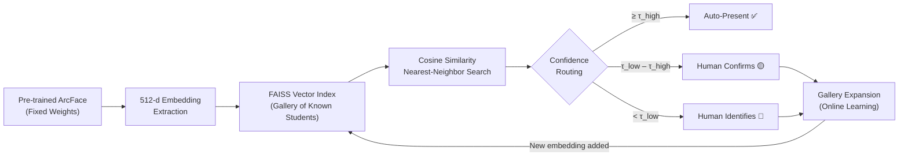
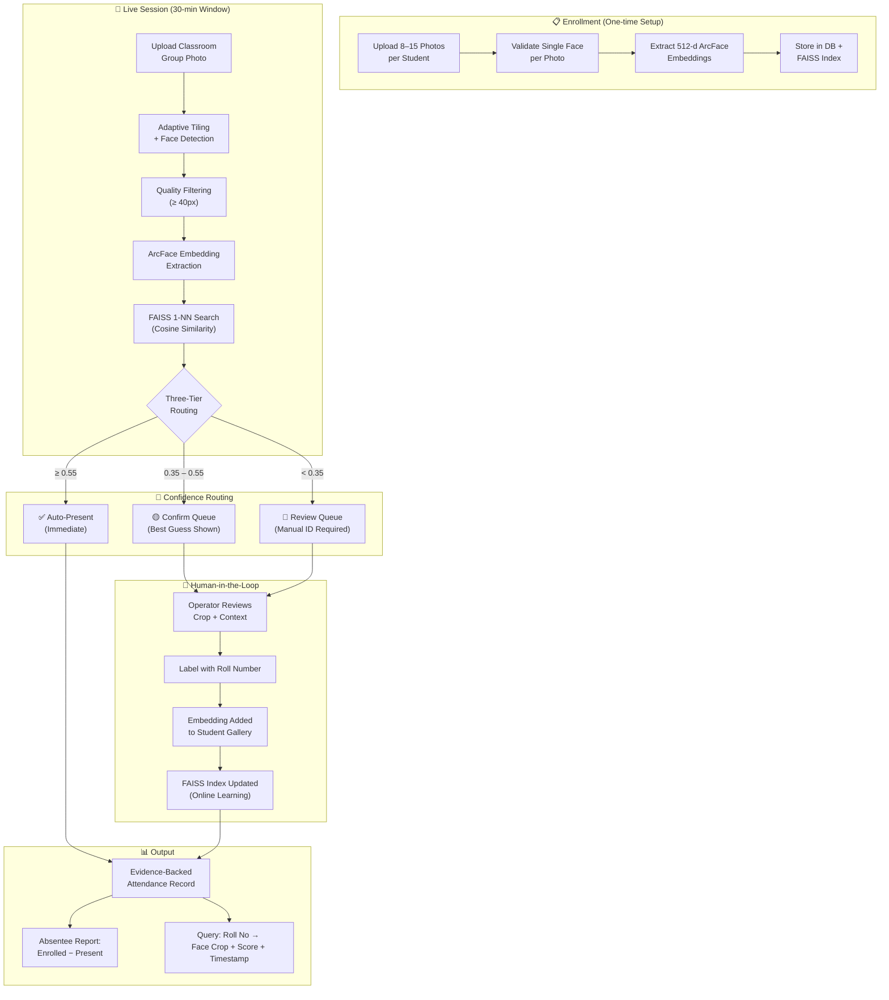

# AI-Based Classroom Attendance Monitoring System
## Refined Problem Statement · Project Objectives · Proposed Research Methodology

---

## 1. Refined Problem Statement

Traditional classroom attendance systems — manual roll calls, sign-in sheets, RFID-based check-ins — suffer from well-documented shortcomings: they are **time-consuming** (consuming 5–10 minutes of instructional time per session), **prone to proxy attendance** (students signing in for absent peers), and **lack verifiable evidence** (no proof that a marked-present student was actually in the room). Biometric alternatives such as fingerprint scanners introduce queuing bottlenecks and hygiene concerns, while individual face-scan turnstiles are impractical for large class sizes.

This project addresses a more challenging and realistic variant of the attendance problem: **simultaneous multi-face recognition from a single wide-angle group photograph of an entire classroom**. Unlike controlled, one-at-a-time face verification (e.g., airport e-gates), a classroom group photo presents compounding difficulties:

- **Scale variation**: faces at the front of the room may span 200+ pixels while back-row faces may occupy fewer than 40 pixels.
- **Occlusion**: students seated behind others are partially blocked in any single frame.
- **Uncontrolled conditions**: variable lighting, head pose, expression, accessories (glasses, masks), and day-to-day appearance changes.
- **Open-set recognition**: new students may join mid-semester, and the system must handle faces it has never seen before without crashing or silently misclassifying them.

A critical constraint is that **the deep learning model cannot be retrained or fine-tuned in deployment**. Retraining a deep embedding network on the fly from sparse, single-instance labels is unstable, slow, and risks catastrophic forgetting of previously learned identities. The system must therefore "learn" new faces and improve over time **without modifying any neural network weights** — relying instead on gallery expansion and vector index updates, which is how production face recognition systems (e.g., Apple Face ID, Google Photos) actually operate.

> [!IMPORTANT]
> **Core technical challenge**: Build a fully automated, evidence-backed attendance pipeline that (a) detects and identifies all faces in a crowded classroom photograph simultaneously, (b) gracefully handles uncertain and unknown faces via a human-in-the-loop review workflow, (c) continuously improves recognition accuracy over the semester through gallery growth — all without any online model retraining.

---

## 2. Project Objectives

### 2.1 Primary Objectives

| # | Objective | Description |
|---|-----------|-------------|
| **O1** | **Multi-face detection in group photos** | Detect all faces present in a single high-resolution classroom photograph, including small/distant faces (back-row students), using adaptive image tiling with overlapping quadrants and Non-Maximum Suppression (NMS) for deduplication. |
| **O2** | **Embedding-based face recognition without retraining** | Extract 512-dimensional face embeddings using a pre-trained ArcFace model (`buffalo_l`) and perform identity matching via FAISS-based cosine similarity search against an enrolled student gallery — with zero modification to model weights. |
| **O3** | **Three-tier confidence routing** | Implement a configurable decision policy that routes each detected face into one of three categories based on similarity score: *auto-present* (high confidence), *confirm* (medium — human verifies a suggested match), or *review* (low — human provides full identification). |
| **O4** | **Human-in-the-loop review with online gallery expansion** | Build a review queue that presents uncertain faces to an operator with visual evidence (cropped face + bounding box on the full frame), and upon resolution, **immediately incorporates the labeled embedding into the student's gallery and FAISS index**, enabling continuous accuracy improvement without retraining. |
| **O5** | **Evidence-backed attendance querying** | For any roll number query, return the **actual face image captured during that session** (not the enrollment photo), along with timestamp, confidence score, and match type — providing verifiable visual proof of attendance. |
| **O6** | **Robust absentee reporting** | Compute the final absentee list as enrolled students minus all students seen (auto-matched or manually resolved) across all frames in the session window. |

### 2.2 Secondary Objectives

| # | Objective | Description |
|---|-----------|-------------|
| **O7** | **Cross-frame deduplication** | Prevent the same unidentified student from generating duplicate review entries across multiple frames within a single session, using embedding similarity comparison against existing pending reviews. |
| **O8** | **Threshold calibration and tuning** | Provide an interactive threshold playground (UI with sliders) that allows operators to visualize how adjusting $\tau_{\text{high}}$ and $\tau_{\text{low}}$ redistributes faces between auto/confirm/review buckets — enabling data-driven threshold tuning on real classroom data. |
| **O9** | **Complete audit trail** | Maintain an immutable log of every attendance event and every manual review resolution (including operator identity, timestamp, and revert history) for accountability and institutional compliance. |
| **O10** | **Production-ready architecture** | Deliver a modular, asynchronous, API-driven system with proper configuration management, storage abstraction, structured logging, and containerized deployment — ready for institutional pilot. |

---

## 3. Proposed Research Methodology

### 3.1 Overall Approach: Transfer Learning + Gallery-Based Open-Set Recognition

The methodology is grounded in **transfer learning** and **metric learning** principles. Rather than training a face recognition model from scratch (which would require millions of labeled face images), the system leverages a pre-trained ArcFace deep neural network that has already learned a highly discriminative face embedding space from large-scale datasets (MS1MV2, ~5.8M images of ~85K identities). Recognition of specific students is achieved not through model specialization, but through **nearest-neighbor search in the learned embedding space** — a gallery-based approach that is both theoretically sound and industrially standard.

### 3.2 Phase 1 — Face Detection & Embedding Extraction

**Model**: InsightFace `buffalo_l` model pack, containing:
- **SCRFD (Sample and Computation Redistribution for Efficient Face Detection)**: A lightweight anchor-free face detector optimized for multi-scale detection, running at $1280 \times 1280$ input resolution.
- **ArcFace (Additive Angular Margin Loss)**: A ResNet-based embedding network that projects aligned face crops onto a unit hypersphere $S^{511}$, producing L2-normalized 512-dimensional vectors.

**Adaptive Tiling Strategy** for high-resolution classroom images:

$$
\text{If } \max(W, H) > 2500 \text{px:} \quad \text{Split into } 2 \times 2 \text{ quadrants with } 15\% \text{ overlap}
$$

Each quadrant is processed independently through the detector, coordinates are mapped back to the full frame, and overlapping detections are merged via **greedy Non-Maximum Suppression**:

$$
\text{Suppress face } j \text{ if } \text{IoU}(b_i, b_j) > 0.5 \text{ and } \text{score}(b_j) < \text{score}(b_i)
$$

**Quality filtering**: Faces with bounding box width or height $< 40$ pixels are discarded as too small for reliable embedding extraction.

### 3.3 Phase 2 — Gallery Construction & Vector Indexing

**Enrollment protocol**: 8–15 photos per student under varying conditions (angle, lighting, expression), each validated to contain exactly one face. This produces a **multi-embedding gallery** per identity — not a single prototype.

**Index structure**: FAISS `IndexFlatIP` (brute-force exact inner product) wrapped in `IndexIDMap` for labeled retrieval. Because all embeddings are L2-normalized before insertion, inner product equals cosine similarity:

$$
\cos(\theta) = \frac{\mathbf{a} \cdot \mathbf{b}}{|\mathbf{a}||\mathbf{b}|} = \mathbf{a} \cdot \mathbf{b} \quad \text{(when } |\mathbf{a}| = |\mathbf{b}| = 1\text{)}
$$

**Matching**: 1-Nearest Neighbor ($k=1$) search returns the closest enrolled student and the corresponding cosine similarity score.

### 3.4 Phase 3 — Three-Tier Confidence Routing & Decision Policy

Each detected face's best-match score is evaluated against two configurable thresholds:

| Score Range | Route | Action |
|-------------|-------|--------|
| $s \geq \tau_{\text{high}}$ (default 0.55) | `auto` | Student marked present automatically; no human intervention |
| $\tau_{\text{low}} \leq s < \tau_{\text{high}}$ (default 0.35–0.55) | `confirm` | Best-guess roll number pre-filled; human confirms or corrects |
| $s < \tau_{\text{low}}$ (default 0.35) | `review` | No guess provided; human must identify from scratch |

> [!TIP]
> The thresholds are **not** taken from ArcFace benchmark papers. They are meant to be calibrated on actual classroom data by sweeping values and plotting False Accept Rate vs. False Reject Rate curves specific to the deployment environment.

### 3.5 Phase 4 — Human-in-the-Loop Review & Online Gallery Expansion

This is the system's core "learning" mechanism — and the key methodological innovation over a static recognition system:

1. **Review presentation**: The operator sees the cropped face (large) alongside the full classroom frame with a red bounding box indicating the face's spatial position — providing both identity and contextual cues.

2. **Resolution and gallery growth**: When the operator labels a face with a roll number:
   - The face's 512-d embedding is **appended to that student's gallery** in both the database and the in-memory FAISS index.
   - The student is marked present for the active session.
   - An immutable audit record is created.

3. **Progressive accuracy improvement**: As the gallery for each student grows over multiple sessions (different days, lighting, angles, expressions), the system's recognition coverage expands naturally:
   - Week 1: 10 enrollment embeddings per student → some misses.
   - Week 8: 10 enrollment + ~15–20 resolved review embeddings → significantly fewer misses.
   - The review queue rate should **monotonically decrease** over the semester.

4. **Cross-frame deduplication**: Before creating a new review entry, the system checks whether a pending review item with cosine similarity $\geq \tau_{\text{high}}$ already exists for the same session — preventing the same unidentified student from flooding the queue across multiple frames.

### 3.6 Phase 5 — Evidence Storage & Attendance Reporting

Every recognition event — whether auto-matched, confirmed, or manually labeled — persists:
- The **actual face crop** captured during the session (visual evidence)
- The full frame path (spatial context)
- The raw embedding (for future re-analysis)
- Confidence score, match type, and timestamp

This enables **evidence-backed querying**: when asked "Was roll number X present?", the system returns the captured face image as proof — not merely a boolean flag.

### 3.7 Evaluation Metrics

| Metric | Definition | Target |
|--------|-----------|--------|
| **Auto-match accuracy** | % of auto-routed faces correctly identified | > 95% after calibration |
| **Review queue rate** | % of detected faces requiring human intervention | Should decrease over the semester |
| **False present rate** | % of students marked present who were not actually there | Near 0% (critical metric) |
| **Processing latency** | Time from frame upload to all faces processed | < 30s per frame (CPU) |
| **Evidence accuracy** | Spot-check that returned face crops match claimed roll numbers | 100% |

### 3.8 Technology Stack Summary

| Layer | Technology | Purpose |
|-------|-----------|---------|
| Face Detection | SCRFD (via InsightFace `buffalo_l`) | Multi-scale face localization in group photos |
| Face Embedding | ArcFace (via InsightFace `buffalo_l`) | 512-d discriminative face representation |
| Vector Search | FAISS (`IndexFlatIP` + `IndexIDMap`) | Sub-millisecond cosine similarity search |
| Backend API | FastAPI (async, background tasks) | REST endpoints with OpenAPI documentation |
| Database | SQLAlchemy (SQLite dev / PostgreSQL prod) | Structured data persistence |
| Image Storage | Local filesystem (S3-ready abstraction) | Face crops, frames, review context images |
| Frontend UI | Streamlit | 5-step workflow: enroll → capture → review → query → report |
| Model Runtime | ONNX Runtime | Efficient inference of pre-trained models |

### 3.9 End-to-End Pipeline Summary

---

> [!NOTE]
> **Key Methodological Principle**: The system achieves continuous improvement through **gallery expansion** (a form of online metric-space learning), not through model retraining. This is both the safest engineering choice and the standard approach in production face recognition systems — the pre-trained ArcFace backbone provides a fixed, high-quality embedding space, while the gallery of known identities grows organically through enrollment and human-verified corrections.
